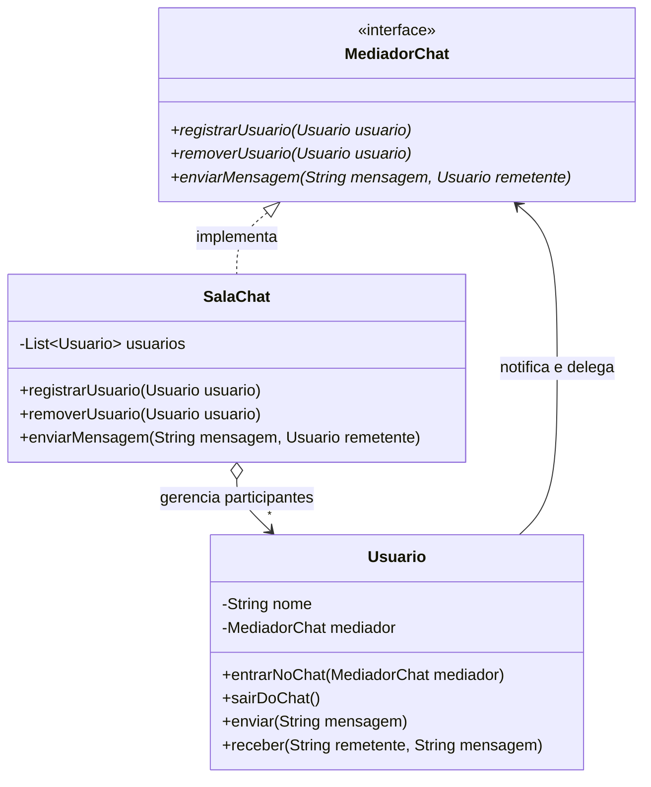

# Projeto: Sala de Chat Refatorada com Padrão Mediator

Este projeto implementa a refatoração de uma sala de chat em Java 17 com Maven, substituindo uma rede de acoplamento direto $\mathcal{O}(N^2)$ (anti-pattern) pelo padrão de projeto comportamental **Mediator** (GoF).

---

## 📌 Problemas do Design Anterior (Anti-pattern)
No cenário original:
1. **Acoplamento Quadrático ($\mathcal{O}(N^2)$):** Cada `Usuario` continha uma lista direta de contatos. Para $N$ usuários, existiam $N \times (N - 1)$ referências cruzadas diretas.
2. **Fragilidade ao adicionar participantes:** Para incluir um novo usuário (ex.: Diego), era necessário instanciá-lo e adicioná-lo manualmente na lista de cada um dos usuários existentes, e vice-versa.
3. **Inconsistência e Vazamento de Memória na remoção:** Para remover um participante (ex.: Carla), todos os outros precisavam remover a referência manualmente; caso esquecido, geravam-se referências órfãs e mensagens entregues indevidamente.
4. **Violação do Princípio da Responsabilidade Única (SRP):** As regras de negócio e transmissão ficavam espalhadas em cada usuário.

---

## 🚀 Solução com o Padrão Mediator

A estrutura foi refatorada para uma topologia estrela (*hub-and-spoke*):
* **`MediadorChat` (Interface):** Define o contrato de intermediação (`registrarUsuario`, `removerUsuario`, `enviarMensagem`).
* **`SalaChat` (Mediador Concreto):** Centraliza a lista de usuários e a lógica de envio (ex.: broadcasting filtrando o próprio remetente).
* **`Usuario` (Colega / Colleague):** Conhece apenas o `MediadorChat`. Permite desacoplamento total, facilitando reutilização em múltiplas salas ou chats privados.

---

## 🛠️ Como Executar

### Pré-requisitos
- JDK 17+
- Apache Maven 3+

### Compilação e Execução
```bash
mvn compile
java -cp target/classes br.venson.net.designpatterns.mediator.Main
```

---

## 📊 Diagrama de Classes


